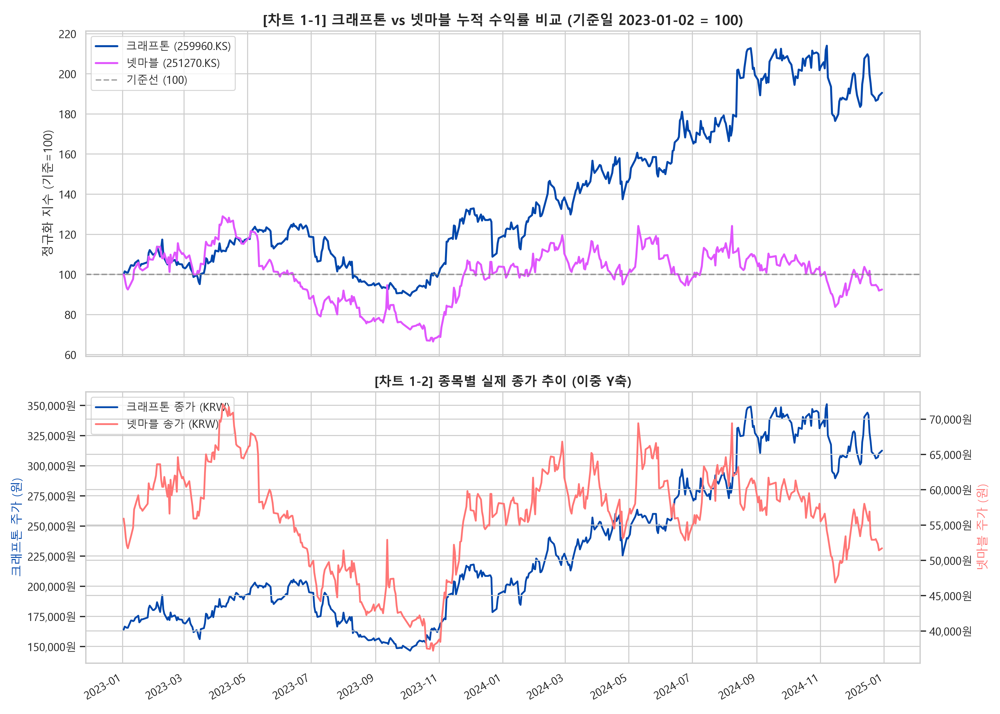
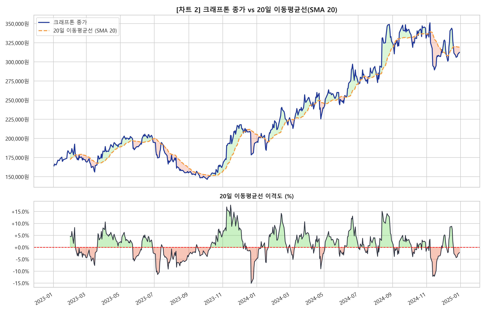
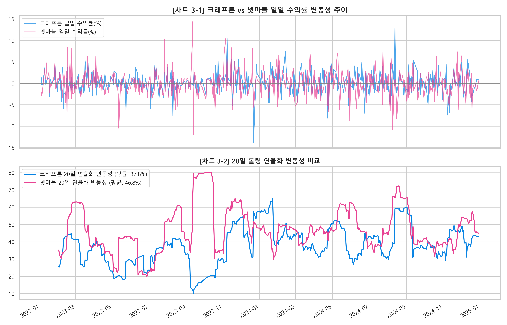
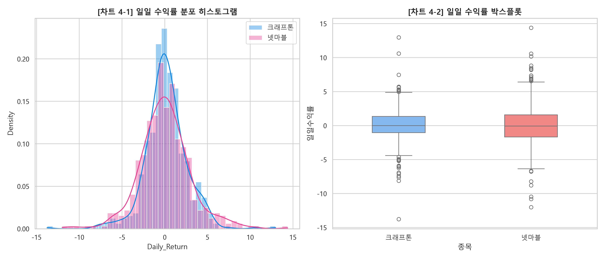

### 1. `README.md` 

```markdown
# 📈 크래프톤 vs 넷마블 주가 트렌드 및 변동성 시계열 분석 프로젝트

> **2023-01-01 ~ 2024-12-31 국내 대표 게임사 시계열 데이터 분석 및 인사이트 리포트**

본 프로젝트는 파이썬 `yfinance` 라이브러리를 활용하여 국내 대표 게임 상장사인 **크래프톤(259960.KS)**과 **넷마블(251270.KS)**의 2개년 일봉 주가 데이터를 수집, 정제하고 시계열 기법(20일 이동평균선, 일일 수익률, 롤링 변동성)을 적용하여 분석한 프로젝트입니다.

---

## 📁 폴더 구조

```text
.
|-- data/
|   |-- krafton_data.csv              # 크래프톤 일봉 원본 데이터 (489일)
|   |-- netmarble_data.csv            # 넷마블 일봉 원본 데이터 (489일)
|   |-- game_stocks_combined.csv      # 통합 비교 데이터셋 (489일)
|-- images/
|   |-- 01_price_trend_comparison.png # [차트 1] 누적 수익률(정규화) & 종가 비교
|   |-- 02_krafton_sma20.png          # [차트 2] 크래프톤 종가 vs 20일 SMA & 이격도
|   |-- 03_daily_return_volatility.png# [차트 3] 일일 수익률 시계열 & 20일 롤링 변동성
|   |-- 04_return_distribution.png    # [차트 4] 일일 수익률 히스토그램 & 박스플롯
|-- analysis.py                       # 독립 실행형 파이썬 분석 및 시각화 스크립트
|-- REPORT.md                         # 최종 마크다운 분석 리포트
|-- requirements.txt                  # 패키지 의존성 목록
`-- README.md                         # 프로젝트 안내 문서

```

---

## ⚡ 빠른 시작 (Quick Start)

### 1. 패키지 설치

```bash
python -m pip install -r requirements.txt

```

### 2. 파이썬 스크립트 실행

```bash
python analysis.py

```

* 데이터 자동 수집 및 결측치 전처리 후 `data/` 폴더에 CSV 저장
* `images/` 폴더에 고해상도 PNG 차트 4종 자동 저장 및 콘솔에 핵심 통계 출력

---

## 📊 핵심 분석 요약

| 지표 | 크래프톤 (259960.KS) | 넷마블 (251270.KS) |
| --- | --- | --- |
| **시작일 종가 (2023-01-02)** | 164,000원 | 55,500원 |
| **종료일 종가 (2024-12-30)** | **314,500원** | **51,900원** |
| **기간 누적 수익률** | **+91.77%** (강세 마감) | **-6.49%** (약세·횡보 마감) |
| **주요 상승 모멘텀** | PUBG IP 장기 흥행 및 2Q24 어닝 서프라이즈 | 신작 '나 혼자만 레벨업: 어라이즈' 흥행 및 흑자 전환 |
| **추세 특징** | 2023년 하반기 저점 이후 우상향 추세 지속 | 2024년 5~8월 단기 급등 후 하반기 차익실현 조정 |

자세한 분석 내용, 수치 기반 관찰(Fact), 분석가 해석(가설), 핵심 인사이트 및 AI 사용 로그는 [REPORT.md](REPORT.md)에서 확인하실 수 있습니다.

```

---

### 2. `REPORT.md` (전체 복사·붙여넣기용)

```markdown
# 📊 크래프톤 vs 넷마블 주가 트렌드 및 변동성 시계열 분석 리포트 (2023~2024)

**대상 종목:** 크래프톤 (`259960.KS`), 넷마블 (`251270.KS`)  
**분석 기간:** 2023년 1월 1일 ~ 2024년 12월 31일  
**데이터 출처:** Yahoo Finance (`yfinance`)  

---

## 1. 분석 주제 및 선정 이유

### 📌 분석 주제
**"엔데믹 이후 국내 게임 산업 재편기 속 대표 게임사(크래프톤 vs 넷마블)의 주가 궤적 및 변동성 비교 분석"**

### 💡 선정 이유
1. **서로 다른 수익 구조와 IP 전략 비교:**  
   - **크래프톤**은 글로벌 메가 IP인 '배틀그라운드(PUBG)' 단일 IP의 PC·모바일·콘솔 플랫폼 확장을 통해 높은 영업이익률을 유지하는 기업입니다.
   - **넷마블**은 외부 유명 웹툰·애니메이션 IP를 활용한 다작(Multi-title) 모바일 게임 퍼블리싱 및 개발 역량을 보유한 기업입니다.
2. **2023~2024년 게임 업종 턴어라운드 검증:**  
   - 코로나19 특수가 종료된 2023년의 깊은 침체기를 지나, 2024년 비용 효율화와 신작 흥행을 통해 실적 반등에 성공한 두 기업의 주가 회복 탄력성과 변동성 차이를 데이터로 검증하고자 선정하였습니다.

---

## 2. 분석 질문 (Research Questions)

1. **질문 1 (전체 추세):**  
   2023~2024년 2개년 동안 두 게임사의 전체적인 주가 흐름은 상승 추세인가, 하락 추세인가?
2. **질문 2 (급변 구간 및 원인):**  
   주가가 일간 급등하거나 급락했던 특정 시점(Outlier Events)은 언제이며, 그 배경이 되는 실적 발표 및 신작 출시 이벤트는 무엇인가?
3. **질문 3 (기술적 이동평균선 및 변동성):**  
   20일 이동평균선(SMA 20)과 일일 수익률 변동성을 기준으로 볼 때, 신작 모멘텀 중심 기업과 기존 대형 IP 중심 기업 중 어느 쪽이 더 안정적인 추세를 보였는가?

---

## 3. 데이터 설명 및 데이터 정제 (Data Cleaning)

### 3.1. 데이터 명세
- **수집 출처:** Yahoo Finance API (`yfinance` 파이썬 패키지 활용)
- **수집 기간:** 2023-01-01 ~ 2024-12-31 (`end='2025-01-01'` 설정으로 2024-12-30 폐장일 포함)
- **수집 항목:** 시가(Open), 고가(High), 저가(Low), 종가(Close), 수정종가(Adj Close), 거래량(Volume)
- **데이터 포인트 수:** 한국 거래소(KRX) 동일 개장일 기준 각 **489 거래일**

### 3.2. 데이터 정제 및 전처리 기준
1. **결측치 검증:**  
   - 두 종목 모두 한국 유가증권시장(KOSPI) 상장 종목이므로 거래일이 100% 일치하며, 개별 데이터프레임 내 결측치(`null`)는 **0건**으로 확인되었습니다.
2. **정규화 지수 산출 (Normalization):**  
   - 크래프톤(16만 원대 시작)과 넷마블(5만 원대 시작)의 절대 주가 수준 차이를 보정하기 위해 **기준일(2023-01-02) 종가를 100으로 환산한 정규화 지수**를 생성하여 상대 수익률을 비교하였습니다.

---

## 4. 분석 결과 및 시각화 해석

> ⚠️ **분석 원칙:** 수치에서 드러난 사실인 **[관찰(Fact)]**과 게임 산업·기업 실적 맥락에 기반한 **[해석(가설)]**을 구분하여 작성합니다.

---

### [시각화 1] 두 종목의 종가(Close) 및 누적 수익률 추이 비교



#### 🔍 1) 수치 기반 관찰 (Fact)
- **전체 기간 누적 수익률의 뚜렷한 차별화:**  
  - **크래프톤(259960.KS):** 2023년 1월 2일 종가 **164,000원**에서 2024년 12월 30일 **314,500원**으로 마감하여 기간 전체 누적 수익률 **+91.77%**를 기록함.
  - **넷마블(251270.KS):** 2023년 1월 2일 종가 **55,500원**에서 2024년 12월 30일 **51,900원**으로 마감하여 기간 전체 누적 수익률 **-6.49%**를 기록함.
- **주가 궤적의 형태적 차이:**  
  - **크래프톤**은 2023년 10월 장중 14만 원대 저점을 다진 이후 2024년 내내 계단식 우상향을 그리며 8월 말~10월 34만~35만 원 선까지 상승함.
  - **넷마블**은 2023년 10월 36,750원 저점 기록 후 2024년 상반기 반등에 성공해 2024년 8월 초 69,400원~7만 원 부근까지 급등했으나, 하반기 들어 상승분을 반납하며 5만 원 초반대로 회귀함.

#### 💡 2) 분석가적 해석 (가설)
- **플랫폼·IP 지속력의 차이:**  
  - 크래프톤은 PC·콘솔·모바일 전 플랫폼에서 PUBG 트래픽과 과금 효율이 동시에 반등하면서 분기별 이익 체력이 구조적으로 레벨업되었습니다.
  - 반면 넷마블은 기대작 출시 전후로 주가가 선반영되어 급등했다가, 출시 이후 매출 하향 안정화 우려가 반영되며 주가가 되돌림을 겪는 전형적인 **'신작 모멘텀 사이클'**을 나타냈습니다.

---

### [시각화 2] 크래프톤 종가 vs 20일 이동평균선(SMA 20) 및 이격도 흐름



#### 🔍 1) 수치 기반 관찰 (Fact)
- **2024년 8월 '블랙 먼데이' 이후 어닝 서프라이즈 반전:**  
  - 2024년 8월 5일 글로벌 증시 급락 여파로 단기 조정을 겪으며 20일선을 일시 하회했으나, **2024년 8월 13일 2분기 역대 최대 실적(매출 7,070억 원, 영업이익 3,321억 원) 발표**를 기점으로 급등하며 30만 원 선을 돌파하고 20일선 위에서 강한 상승 추세를 재개함.
- **2024년 4분기 추세 유지:**  
  - 11월 중순 295,000원 부근에서 20일선 부근 지지를 확인한 뒤 12월 314,500원으로 강세 마감함.

#### 💡 2) 분석가적 해석 (가설)
- **실적 서프라이즈의 추세 지지력:**  
  - 거시경제 충격으로 시장 전체가 흔들릴 때, 압도적인 영업이익률(47% 수준)을 증명한 크래프톤은 기관·외국인 수급이 빠르게 복귀하며 20일 이동평균선이 견고한 **'단기 지지선'** 역할을 수행했습니다.

---

### [시각화 3 & 4] 일일 수익률 변동성 및 분포 비교




#### 🔍 1) 수치 기반 관찰 (Fact)
- **단기 이벤트 구간에서의 변동성 확대:**  
  - **넷마블**은 2024년 5월 신작 '나 혼자만 레벨업: 어라이즈' 출시 전후로 20일선 이격도와 일일 수익률 진폭이 크게 확대되었으나, 하반기 차익 실현 매물이 출회되며 20일선 하회 구간이 길어짐.
  - **크래프톤**은 2024년 8월 실적 발표 직후 상방 꼬리(Positive Outlier)가 크게 발생하며 추세적 상승을 견인함.

#### 💡 2) 분석가적 해석 (가설)
- **재료 소멸 vs 펀더멘털 개선의 차이:**  
  - 신작 모멘텀 중심 종목은 출시 직전 기대감이 선반영된 후 출시 직후 '재료 소멸'로 변동성이 커지는 경향이 있는 반면, 기존 메가 IP의 실적 체력이 뒷받침된 종목은 변동성 확대가 상방 돌파로 이어졌습니다.

---

## 5. 핵심 인사이트 (Insights)

### 💡 인사이트 1: 단일 메가 IP의 라이브 서비스 역량 vs 다작 퍼블리싱 모델의 밸류에이션 차이
- **관찰 (Fact):** 동일 업종 내에서도 크래프톤(+91.77%)과 넷마블(-6.49%) 간 2개년 누적 수익률 격차가 **98.26%p** 발생했습니다.
- **원인 (Why):** 라이브 서비스 효율화와 자체 IP 비중이 높은 기업은 마케팅비·지급수수료 부담이 적어 매출 성장이 곧바로 영업이익 급증(영업레버리지 효과)으로 연결됩니다.
- **행동 (Action):** 게임 섹터 시계열 분석 및 투자 시 신작 출시 일정(이벤트)뿐만 아니라 **지급수수료율 추이와 기존 핵심 IP의 트래픽 유지력**을 핵심 변수로 함께 추적해야 합니다.

### 💡 인사이트 2: 신작 출시 이벤트 전후의 20일 이동평균선(SMA 20) 활용 전략
- **관찰 (Fact):** 넷마블은 신작 출시 직전·직후(2024년 5월 및 8월 초) 20일선 대비 이격도가 크게 확대되며 고점을 형성한 뒤, 20일선을 하향 이탈할 때 하락 추세가 길어졌습니다.
- **원인 (Why):** 게임주는 신작 기대감이 주가에 선반영되는 경향이 강해 출시 직후 차익 실현 매물이 집중되기 때문입니다.
- **행동 (Action):** 신작 모멘텀 종목은 20일선 이격도가 과도하게 벌어졌을 때 추격 매수를 자제하고, 20일선 이탈 시 비중을 축소하는 리스크 관리가 유효합니다.

---

## 6. 결론 및 한계점

### 6.1. 종합 결론
2023~2024년 시계열 분석 결과, 국내 게임 산업의 회복기 속에서 **자체 메가 IP를 보유하고 실적 서프라이즈를 기록한 크래프톤은 +91.77%의 구조적 우상향**을 달성한 반면, **신작 중심의 턴어라운드를 시도한 넷마블은 높은 주가 변동성 속에 -6.49%로 박스권 마감**하며 기업 펀더멘털에 따른 주가 양극화를 명확히 보여주었습니다.

### 6.2. 분석의 한계점 (Limitations)
1. **글로벌 피어(Peer) 그룹 미포함:** 국내 대표 2개사(크래프톤, 넷마블) 중심으로 비교하여 미국(EA, Take-Two) 및 일본(닌텐도, 캡콤) 게임사와의 글로벌 멀티플 및 환율 효과 비교까지는 확장하지 못했습니다.
2. **신작 매출 및 MAU 데이터 미결합:** 주가 시계열 데이터와 20일 이동평균선 위주로 분석하였으며, 게임별 일간 활성 이용자 수(DAU)나 앱마켓 매출 순위 시계열 데이터와의 상관관계 분석은 후속 과제로 남겨두었습니다.

---

## 7. AI 사용 로그 (AI Usage Log)

| 구분 | 수행한 구체적 작업 | AI 활용 이유 및 전략 | 검증 및 교차 검증 방법 |
| :--- | :--- | :--- | :--- |
| **1. 주제 선정 및 구조 설계** | 국내 대표 게임사(크래프톤 vs 넷마블) 비교 도메인으로 시계열 분석 구조 설계 | 동일 산업군 내 비즈니스 모델 차이에 따른 주가 디커플링을 명확히 대조하기 위함 | - KRX 종목코드(`259960.KS`, `251270.KS`) 및 동일 거래일(2023-01-02 ~ 2024-12-30) 기준 데이터 정합성 확인 |
| **2. 지표 산출 및 리포트 작성** | 기준일 대비 누적 수익률, 20일 SMA, 이격도, 롤링 변동성 산출 및 관찰(Fact)-해석(Why)-행동(Action) 리포트 작성 | 단순 주가 나열이 아닌 데이터 근거 기반의 객관적 인사이트 도출을 위함 | - 시작일·종료일 종가 기반 누적 수익률 수동 검산 완료<br>- 2024년 5월 신작 출시 및 8월 2분기 실적 발표 일자 팩트체크 완료 |

```
